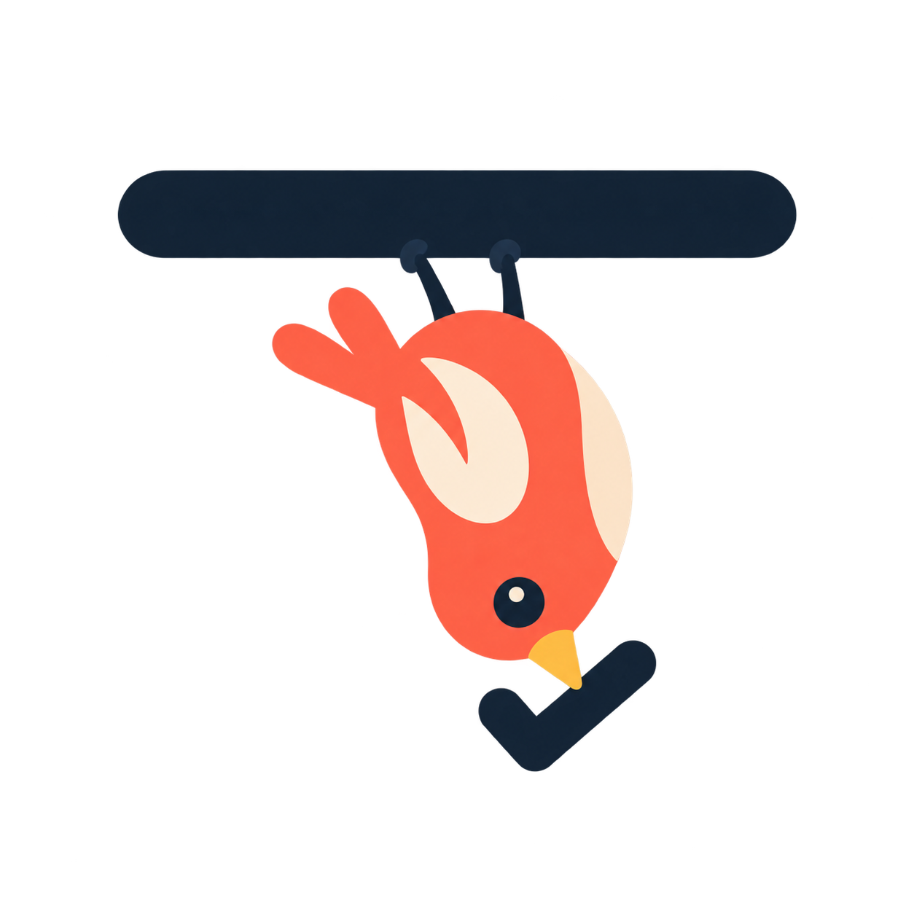

# Perch



A notch to-do list for Mac. Perch grows out of your MacBook's notch: at rest
it shows your next few tasks in a small, dimmed shape under the camera, and
when you hover over it, it expands into the full list. You can add, edit,
reorder and check off tasks, park things for later, and set reminders.
Perchie, the bird from the app icon, keeps it company.

> **Status: in development.** Perch is a work in progress. Features,
> settings and the saved-data format may change between versions, and there
> are no official releases yet. Build it from source (see below).

On Macs without a notch (external displays, iMac, Mac mini, older MacBooks)
it falls back to a small bar at the top-center of the screen.

## Requirements

- macOS 13 Ventura or later
- Xcode 15+ / Swift 5.9+ command line tools

## Build & run

```sh
./Scripts/build_app.sh
open build/Perch.app
```

This compiles a release build and packages it into `build/Perch.app`,
ad-hoc signed for local use. `build/` and `.build/` are git-ignored.

To use Perch day to day, copy `build/Perch.app` into `/Applications` and
launch it from there. Login Item registration is tied to the app's path, so
if "Launch Perch at login" stops working after you move the bundle, toggle it
off and on again in Settings.

For iterating on the code during development:

```sh
swift build
swift run
```

`swift run` runs the bare executable, not a `.app` bundle. Without a bundle
identifier, **Launch at login and reminder notifications don't work**
(reminders are silently skipped instead of crashing). Use the `.app` build to
test either of those.

## Using it

### At rest (the glance)

- Your first three tasks show under the notch, with a "+N more" row if there
  are others. With no tasks it shrinks to a thin lip around the notch.
- By default the glance is frosted glass with a dark tint. You can make it
  solid black, or change how dark the tint is, in Settings.

### Expanded (hover)

- **Hover** over the shape to expand it. It collapses shortly after the
  cursor leaves.
- **Add:** type in "Add a task…" and press Return (or click **+**).
- **Complete:** click the circle next to a task. It moves to "Recently
  completed" with a timestamp. Click its checkmark to undo.
- **Edit:** click a task's title to edit it in place. Return or clicking away
  saves; Escape reverts.
- **Reorder:** drag a task by its handle.
- **Future:** click the arrow on a task (or right-click → Move to Future) to
  park it in the Future section. These are things to remember but not do yet.
  Move them back the same way.
- **Reminders:** click the bell on a task and pick 30m, 1hr, 2hr, Tomorrow
  (9 am) or a custom date and time. The reminder time shows on the row and
  turns orange once it has passed. macOS asks for notification permission the
  first time you set one.
- **Delete:** use the trash can that appears on hover, or right-click →
  Delete.
- **Hide the list:** click the "Perch" title to collapse to just the title
  bar. It stays out until you click the title again.
- **Perchie:** when hanging below the shape, drag it along the bottom edge to
  reposition it.

### Settings

Open Settings with the gear icon in the expanded panel, or from the menu bar
icon → Settings… (⌘,).

- **Startup:** Launch Perch at login; Start expanded
- **Appearance:** translucent (frosted) or solid glance, tint strength, and where
  Perchie appears (None, Hanging, or Top of screen next to the camera)
- **Completed tasks:** how many recent completed tasks to show (3–15)
  before the rest go under "Show all completed"; Clear completed history

Perch has no Dock icon by design. The menu bar icon is how you reach
Settings and Quit.

### Data

Tasks are stored locally at `~/Library/Application Support/Perch/tasks.json`.
Settings live in the app's `UserDefaults` (`com.evieeangeline.perch`).

## Project layout

```
Sources/Perch/
  main.swift              App entry (accessory app, no Dock icon)
  App/                    AppKit side: panel, window controllers, notch
                          geometry/layout, hover state
  Models/                 PerchTask
  Store/                  TaskStore (JSON persistence), SettingsStore,
                          ReminderScheduler, LoginItemManager
  Views/                  SwiftUI: glance, expanded list, rows, reminder
                          picker, settings, notch shape, Perchie
  Resources/              Images bundled via SwiftPM (status bar icon, Perchie)
Resources/                Info.plist and AppIcon.icns, used by build_app.sh
Scripts/build_app.sh      Builds and packages Perch.app
Tests/PerchTests/         Unit tests (Swift Testing)
Design/                   Source artwork (not shipped in the app)
```

## How it's built

- Swift Package Manager + AppKit + SwiftUI, with no Xcode project.
- A borderless, non-activating `NSPanel` (`.statusBar` level, on every Space
  including full-screen apps) hosts the SwiftUI content. It never steals
  focus unless you click into it.
- **The window never resizes.** It's a fixed, transparent rectangle big
  enough for the tallest expanded state, and SwiftUI animates the visible
  shape (`NotchShape`, with concave "ears" that flow into the top edge like
  the notch itself) inside it. That keeps expand/collapse smooth.
- **Hover is tracked in AppKit, not with `.onHover`.** Global and local
  `NSEvent` mouse monitors compare the cursor to the visible shape's rect
  (from `NotchLayout`, which both sides share). The panel ignores mouse
  events everywhere outside the shape, so the transparent area never blocks
  the menu bar. No Accessibility permission is needed.
- Notch geometry comes from `NSScreen.safeAreaInsets` and
  `auxiliaryTopLeftArea` / `auxiliaryTopRightArea`, with no hardcoded pixel
  widths. The layout is recomputed when displays change.
- Reminders use `UNUserNotificationCenter`, with one pending notification per
  task (keyed by task ID). They're resynced from disk on launch.
- Launch at login uses `SMAppService.mainApp` (ServiceManagement).

## Tests

```sh
swift test
```

Tests use [Swift Testing](https://developer.apple.com/xcode/swift-testing/)
and live in `Tests/PerchTests/`. They cover the logic that doesn't need a
window:

- `TaskStoreTests`: adding, completing, renaming, deleting, Future,
  reordering (including keeping completed tasks in their slots), reminders,
  and saving/loading. Each test uses a temporary `tasks.json` and a fake
  reminder scheduler, so your real tasks and notifications are never touched.
- `PerchTaskTests`: JSON round-trips and loading tasks saved by older
  versions.
- `NotchLayoutTests`: glance, expanded and hidden-list sizes, and where the
  hanging Perchie is allowed to sit.
- `SettingsStoreTests`: fresh-install defaults, persistence, and when the
  login item is (and isn't) updated. Uses a throwaway `UserDefaults` suite
  and a stand-in for the login item, so your real settings are untouched.
- `ReminderLabelTests`: the "3:00 pm" / "Tomorrow 9:00 am" / "Tue 21 Oct"
  labels, pinned to a fixed date, time zone and locale.

For a coverage report:

```sh
swift test --enable-code-coverage
xcrun llvm-cov report .build/debug/PerchPackageTests.xctest/Contents/MacOS/PerchPackageTests \
  -instr-profile "$(dirname "$(swift test --show-codecov-path)")/default.profdata" \
  -ignore-filename-regex='Tests/|\.build/'
```

The SwiftUI views, the window/hover controller, notifications and login
items aren't covered yet. They need a running app or a UI test harness.
